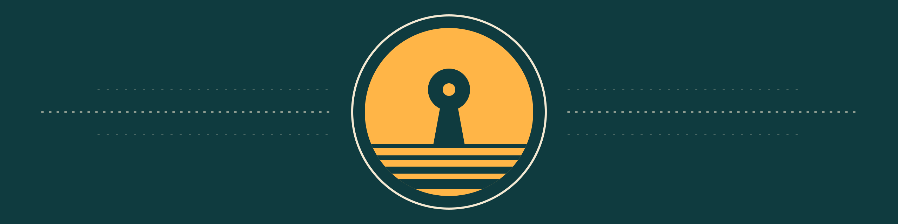
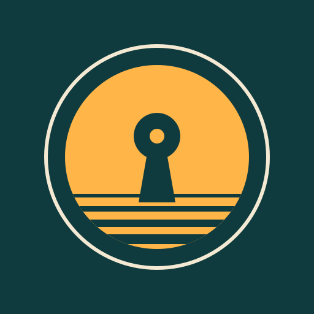

<i>I like working with people who care about craft, context, and shipping the useful version.</i>

 

## ✦ About

<table>
<tr>
<td width="140" align="center" valign="top">
  
</td>
<td valign="top">

- **Role:** AI engineer / security / software developer
- **Philosophy:** craft, context, and shipping the useful version
- **Focus now:** Python, with Kotlin and HTML in the build queue
- **Currently building:** tools that catch problems early, such as [firedamp](https://github.com/pr60t/firedamp)
- **Style:** minimal, sophisticated, a little retro, always in public
- **Open to:** thoughtful collaboration, ambitious products, and useful open source

</td>
</tr>
</table>

 

## ✦ Featured work

<table>
<tr>
<td width="50%" valign="top">

### [firedamp](https://github.com/pr60t/firedamp)
Canaries for your RAG stack. Detect the leak before it reaches a user.

`Python` · 🔐 AI security

</td>
<td width="50%" valign="top">

### [chrona](https://github.com/pr60t/chrona)
[one-line description of chrona]

`Kotlin` · 🛠 Build in progress

</td>
</tr>
</table>

 

## ✦ Toolbox

<b>Current focus and build queue</b>

 

| # | Language | Status |
|---|----------|--------|
| 01 | Python | Current focus |
| 02 | Kotlin | In the build queue |
| 03 | HTML | In the build queue |

 

## ✦ Signal

<table>
<tr>
<td align="center" width="50%">
  
</td>
<td align="center" width="50%">
  
</td>
</tr>
</table>

 

## ✦ The trail behind the work

  

<picture>
  <source media="(prefers-color-scheme: dark)" srcset="https://raw.githubusercontent.com/pr60t/pr60t/output/github-snake-dark.svg">
  <source media="(prefers-color-scheme: light)" srcset="https://raw.githubusercontent.com/pr60t/pr60t/output/github-snake.svg">
  
</picture>

 

Make something worth noticing.

